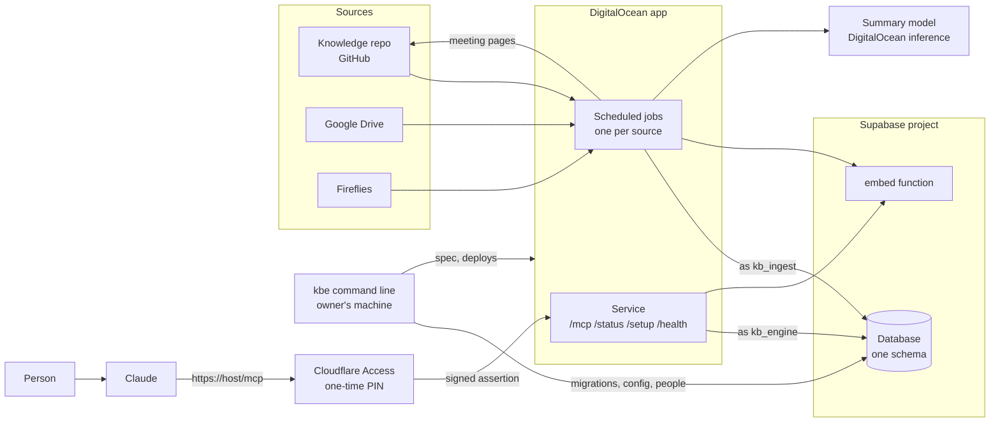

# Architecture

The parts of an Engine, what runs where, and how data moves between them.
For what the Engine does from the owner's side, see [manual.md](manual.md).
For sign-in and the setup page in detail, see [security.md](security.md).

## The parts

| Part | What it is | Where it runs | Code |
|---|---|---|---|
| The service | A Node.js web service. Serves the connector (`/mcp`), the status page (`/status`), the setup page (`/setup`) and `/health` | One DigitalOcean App Platform service, smallest instance size, one instance | `engine/` |
| The Claude plugin (default ingest) | Each person's own Claude copies new items from their connectors into the Engine with `record_source_item`, on a scheduled task on the smallest model. See [plugin.md](plugin.md) | The person's Claude | `plugin/qb-engine/` |
| The jobs (pullers), optional server mode (off by default; `kbe deploy render --server-mode`) | One scheduled Python job per enabled source. Reads the source with the owner's own credential, stores what changed | DigitalOcean App Platform scheduled jobs in the same app, once a day | `pullers/`, `scripts/knowledge/` |
| The database | One Postgres schema: raw captures, documents, people, grants, review state, settings, the issue log, run events | The owner's Supabase project | `supabase/migrations/` |
| The embed function | Turns text into a 384-number vector. Called by the service (for a query) and by the jobs (for documents) | A Supabase edge function in the same project | `supabase/functions/embed/` |
| The summary model | Writes the short summary ("distillation") of each document | DigitalOcean serverless inference, called by the jobs | `scripts/knowledge/distill.py`, `model_client.py` |
| The curator | Turns raw items into small page changes, queues large ones for a yes, writes page summaries. Started by a Supabase cron poke on `/internal/curator/tick` | Inside the service; the model is DigitalOcean serverless inference (`curator_settings.model`), key in Supabase Vault | `engine/src/curator/`, migration 0053 |
| Sign-in | Two Cloudflare Access applications in front of the hostname, and the DNS record | The owner's Cloudflare account | created by `engine/src/setup/` |
| The knowledge repo | A private GitHub repository: Markdown pages and `.kb-engine/engine.yaml` | The owner's GitHub account, and a local clone | template in `templates/knowledge-repo/` |
| The command line | `kbe`: sets an Engine up and looks after it | The owner's machine | `scripts/kbe/` |

Nothing owner-specific is in this repository. The topics, the sources, the
owner and the hostname come from the config file in the knowledge repo and
from the database.

## Diagram



## How data flows in

1. A job starts on its schedule. It first asks the database whether sign-in
   is set up. If not, it logs one line and exits; nothing is read
   (`pullers/access_gate.py`).
2. On the wiki job only: if `.kb-engine/engine.yaml` in the knowledge repo
   has changed and is valid, it is applied to the database. An invalid file
   is rejected whole and an issue is logged; the last good config stays.
3. The job takes a lock for its source, reads what changed since its stored
   cursor, and saves each raw item ("bronze", `raw_captures`).
4. Each item becomes a document ("silver", `documents`). Its topics are
   decided from tags at the source ([tagging.md](tagging.md)). The summary
   model writes a distillation; the embed function turns it into a vector.
5. Items that are gone from a source that is read in full are marked
   deleted, not removed.
6. The run is recorded in `events`. A failed run opens or updates one issue;
   the next clean run closes it.

A document becomes approved ("gold") when a reviewer says so. Approved
documents rank above unreviewed ones in search. See
[manual.md](manual.md#6-review-and-approval).

## How data flows out

1. A person asks Claude something. Claude calls a tool on the connector at
   `https://<host>/mcp`.
2. Cloudflare Access is in front of the hostname. It has signed the person
   in (one-time PIN by email) and adds a signed assertion to the request.
3. The service verifies the assertion itself on every request: signature,
   issuer, audience, expiry. It answers only on its own hostname.
4. The service calls a database function with the verified identity. The
   function looks up the person's topics and filters in SQL. The service
   never receives a row the person may not see.
5. For a search, the service first gets a vector for the query from the
   embed function.

The connector's tools are `search`, `get_document`, `get_wiki_page`,
`who_knows` and `report_issue`; the page tools `get_entity_schema`,
`find_entity`, `list_entities`, `related`, `save_page`, `update_page`,
`record_source_item`, `get_source_item` and `get_ingest_plan` (read-only, 0055); plus seven administrator tools
for people, grants and the issue list. The page tools write only the
caller's own pages and raw items (migrations 0046 to 0052). There is no tool that writes an answer; Claude writes the answer from
the evidence it is given.

## The two database roles

The service and the jobs do not connect as a database user with a password.
Each signs a short-lived token with the project's JWT secret, naming its own
role, and calls the project's REST API with it.

| Role | Used by | Can | Cannot |
|---|---|---|---|
| `kb_engine` | The service | Call the read functions, which filter by the caller's identity; call the admin and issue-report functions | Read or write any table directly. It holds zero table grants |
| `kb_ingest` | The jobs, and `kbe config apply` | Insert and update what ingestion writes; read and apply the config | Delete. Content that is gone is marked, never removed |

A third role is optional:

| Role | Used by | Can |
|---|---|---|
| `kb_support` | A support person, when the owner turns it on | Read the issue inbox view and mark issues. Nothing else in the schema. See [care-plan.md](care-plan.md) |

The service-role key is not used by the service or the jobs. It stays on the
owner's machine for the admin scripts (minting a token, the access tests).
The direct database connection (`KBE_DATABASE_URL`) is also used only on the
owner's machine, by `kbe db`, `kbe people`, `kbe support` and the SQL checks
of `kbe verify`.

`kb_engine` holding no table grants can be checked:

```sql
select count(*) from information_schema.role_table_grants where grantee = 'kb_engine';
-- 0
```

`python -m kbe verify --phases access_control` runs this check.

## Where each setting lives

| What | Where | Why there |
|---|---|---|
| Owner, topics, sources, tag prefix, model, status page layout | `.kb-engine/engine.yaml` in the knowledge repo, applied to `engine_settings.config` | It changes over time and should have a history. The service needs no GitHub access to read it |
| Sign-in settings (team domain, AUD tags, hostname, level) | `engine_settings.access`, written by the setup page | Not secret. Known only after Cloudflare is set up |
| Who may sign in (the email or domain list) | The Cloudflare sign-in rule | The Engine holds no Cloudflare key |
| Who sees what | `principals` and `access_grants` | Enforced in SQL |
| The schema name | `KB_SCHEMA`, an environment variable | The code needs it before it can read any setting |
| Secrets | The local env file, and the DigitalOcean dashboard | Never in a repository |
| Setup progress on the owner's machine | `.kb-engine-local/state.json` | Not secret; lets a later session continue |

[configuration.md](configuration.md) lists every key and variable.

## The service's modes

| Mode | When | What answers |
|---|---|---|
| Setup | No sign-in settings in the environment or the database | `/health` and `/setup` only. Everything else: `503 setup not complete` |
| Ready | Sign-in settings are present | Everything, on the Engine's hostname only. Another `Host` gets 421. `/health` answers on any hostname |
| Unavailable | Settings cannot be read, or stored sign-in settings are damaged | 503 on every route except `/health` |

The service never treats "cannot read the settings" as "not set up".

## Repository layout

```
engine/              the service (TypeScript)
  src/auth/          verifying the Cloudflare assertion; matching it to a person
  src/tools/         the connector's tools; admin/ holds the administrator tools
  src/setup/         the one-time setup page and the Cloudflare calls it makes
  src/status/        the status page
  src/config/        reading the applied config and the sign-in settings
  deploy/            the app spec template
pullers/             one module per source, and the shared runner
scripts/knowledge/   the library the jobs use: ingest, tags, summaries, review
scripts/kbe/         the kbe command line
scripts/obs/         the run-event log
supabase/migrations/ the database, applied in order by `kbe db migrate`
supabase/functions/  the embed function
supabase/tests/      SQL tests, run against a throwaway database
config/              the example config and its generated schema
setup/manifest.yaml  the setup phases and the checks `kbe verify` runs
templates/           the starter knowledge repo
docs/                this documentation
.claude/skills/      the guided setup, administration and tagging skills
```
